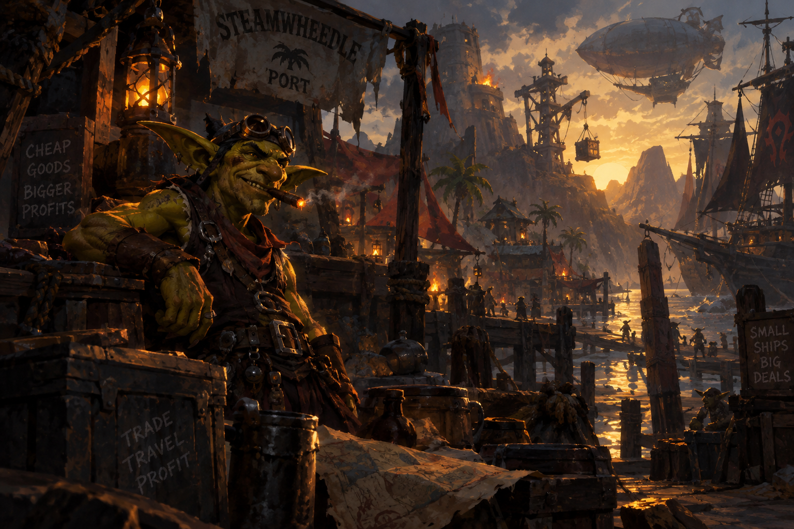

<p align="center">
  
</p>

# Omarchy Goblin Merchant Theme

An Omarchy theme for Steamwheedle Port at dusk. Lantern amber and goblin green glow over dark crates, harbor haze and brass.

This is a dark theme.

## Install

```sh
omarchy-theme-install https://github.com/csfh/omarchy-goblin-merchant-theme
```

You can also install it from the Omarchy menu with `Super + Alt + Space`, then `Install > Style > Theme`, using this repository URL:

```text
https://github.com/csfh/omarchy-goblin-merchant-theme
```

## Palette

| Role | Hex |
| --- | --- |
| Background | `#120b07` |
| Foreground | `#ffffff` |
| Accent | `#d08a28` |
| Red | `#8a3a1f` |
| Green | `#7a8a2f` |
| Yellow | `#d08a28` |
| Blue | `#3a5f78` |
| Magenta | `#7a3a3a` |
| Cyan | `#2f7a72` |

## Included

A `colors.toml` palette, an icon theme (`Yaru-wartybrown-dark`) and a wallpaper. Omarchy builds the terminal, editor, launcher, notification, bar, lock screen, browser and TUI themes from this palette, so `colors.toml` is the single source of truth.

## Backgrounds

The wallpaper:

- [`goblin-merchant`](backgrounds/goblin-merchant.png)

## License

MIT. See [LICENSE](LICENSE). Copyright (c) 2026 Christoffer Hallas.

If you send a pull request or other contribution, you agree to the [CLA](CLA.md).
